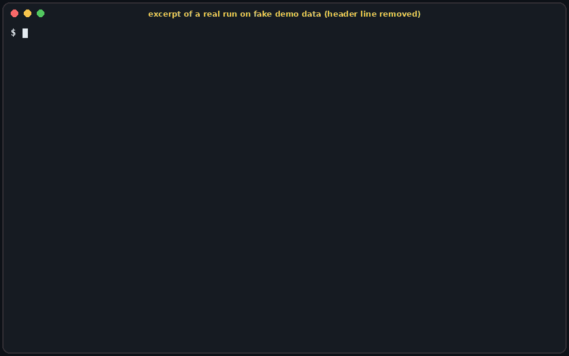

# webhook-crash-lab

**HTTP 200 does not mean your webhook is correct.**

`webhook-crash-lab` crash-tests a webhook handler (Stripe, GitHub, Razorpay or Standard Webhooks signatures) on your machine or in CI. It replays the deliveries that break real apps (duplicates, parallel retries, out-of-order events, a retry after a failed write, forged, unsigned, stale and malformed requests) and then checks your **business state**: credits granted once, one ledger row, one BullMQ job.

[](https://github.com/Krrishkumar125/webhook-crash-lab/actions/workflows/ci.yml)
[](https://www.npmjs.com/package/webhook-crash-lab)
[](https://www.npmjs.com/package/webhook-crash-lab)
MIT · TypeScript · zero runtime dependencies · Node 20+

## 60-second demo

```bash
npx webhook-crash-lab demo --html report.html
```



This runs a bundled "AI credits" app twice: first the kind of handler AI tools often generate, then the fixed version.

```
=== BROKEN handler ===
  PASS  single-valid           One valid delivery
  PASS  duplicate-sequential   Same event delivered again (retry)
  FAIL  duplicate-concurrent   Same event delivered in parallel
        business state: credits: expected 100, got 500; ledgerEntries: expected 1, got 5; jobs: expected 1, got 5.
        Fix: Claim the event id atomically (INSERT ... ON CONFLICT DO NOTHING, Redis SET NX, BullMQ jobId = event.id) ...
  FAIL  out-of-order           Related events arrive out of order
  PASS  invalid-signature      Forged signature
  FAIL  missing-signature      No signature header        -> crashed with 500
  FAIL  stale-timestamp        Old, replayed delivery     -> accepted, granted credits
  FAIL  malformed-json         Broken JSON body           -> crashed with 500
  FAIL  retry-after-failure    Retry after a failed write -> payment lost
  3 passed, 6 failed, 0 not tested

=== FIXED handler ===
  9 passed, 0 failed, 0 not tested
```

Open `report.html` for a plain-English version you can share with a non-technical cofounder. The demo source is in [`src/demo/app.ts`](src/demo/app.ts).

## Use it in your tests (Vitest / Jest)

```ts
import { runCrashLab, assertNoCrashes } from 'webhook-crash-lab';
import { app } from '../src/app'; // Hono, or any (req: Request) => Response handler
import { db } from '../src/db';

it('stripe webhook survives duplicate, concurrent and out-of-order delivery', async () => {
  const result = await runCrashLab({
    target: (req) => app.fetch(req), // or a URL: 'http://localhost:3000/webhooks/stripe'
    secret: 'whsec_test_secret', // the secret your handler verifies with in tests
    event: {
      id: 'evt_1',
      type: 'checkout.session.completed',
      data: { object: { id: 'cs_1', metadata: { userId: 'u1' } } },
    },
    adapter: {
      reset: () => db.truncateAll(),
      observe: async () => ({
        credits: await db.credits('u1'),
        ledgerEntries: await db.ledger.count(),
      }),
    },
    expect: { once: { credits: 100, ledgerEntries: 1 } },
    sequence: {
      events: [
        ,/* checkout.session.completed */
        /* charge.refunded */
      ],
      expected: { credits: 0 },
    },
  });
  assertNoCrashes(result); // throws a readable report listing what failed and how to fix it
});
```

## Scenarios

| id                     | sends                                                                                 | passes when                                                                           |
| ---------------------- | ------------------------------------------------------------------------------------- | ------------------------------------------------------------------------------------- |
| `single-valid`         | the event once                                                                        | 2xx, state equals `expect.once`                                                       |
| `duplicate-sequential` | the same event 3× in a row                                                            | 2xx each, state still equals `expect.once`                                            |
| `duplicate-concurrent` | 5 identical copies in parallel                                                        | 2xx each, state still equals `expect.once`                                            |
| `out-of-order`         | your `sequence` reversed                                                              | no 5xx, state equals `sequence.expected`                                              |
| `invalid-signature`    | signed with the wrong secret                                                          | 4xx, state unchanged                                                                  |
| `missing-signature`    | no signature header                                                                   | 4xx (not 500), state unchanged                                                        |
| `stale-timestamp`      | valid signature, 10 minutes old                                                       | 4xx, state unchanged                                                                  |
| `malformed-json`       | valid signature, truncated body                                                       | 4xx (not 500), state unchanged                                                        |
| `retry-after-failure`  | the event while your adapter makes the business write fail, then the same event again | non-2xx first (so the provider retries), 2xx on the retry, state equals `expect.once` |

### Retry after a failed write

The most expensive webhook bug returns no error at all. The handler saves the event id as processed, then the payment or credit write fails. The provider retries, the handler sees a known id, answers `200 duplicate`, and the payment is gone. Event-id dedupe alone causes it.

To test it, give your adapter a `failNextEffect()` that makes the next business write throw once:

```ts
adapter: {
  reset: () => db.truncateAll(),
  observe: async () => ({ credits: await db.credits('u1') }),
  failNextEffect: () => db.failNextWrite(), // your test double throws on the next insert
},
```

crash-lab sends the event (the write fails), then sends it again like the provider would. It passes when the failed delivery got a non-2xx answer and the retry applied the effect exactly once. The usual fix is to write the event id in the same transaction as the business change, or to delete the claim when the work fails. Without `failNextEffect` the scenario is reported as not tested.

**Nothing is silently passed.** If you don't give an adapter, `expect.once` or `sequence`, those checks are reported as **not tested**.

**Every delivery has a deadline.** A handler that doesn't respond within `timeoutMs` (default 10000) fails the scenario instead of hanging the run, and the request's `signal` is aborted so your handler can stop work.

Stripe signatures use the `t=...,v1=...` HMAC-SHA256 scheme and are verified against the official `stripe` library in this repo's tests. Other schemes: see [Providers](#providers).

## Examples

- [Express](examples/express/app.ts): raw body, signature check, atomic claim. Tested in CI against a real server.
- [Next.js App Router + Prisma](examples/nextjs-prisma/README.md): pass the route's `POST` straight in, unique `eventId` as the claim.

## Providers

| `provider`         | headers sent                                                                                                          | stale-timestamp |
| ------------------ | --------------------------------------------------------------------------------------------------------------------- | --------------- |
| `stripe` (default) | `Stripe-Signature: t=...,v1=...`                                                                                      | tested          |
| `github`           | `X-Hub-Signature-256: sha256=...`, `X-GitHub-Delivery`                                                                | not tested      |
| `razorpay`         | `X-Razorpay-Signature` (hex HMAC of the raw body), `X-Razorpay-Event-Id`                                              | not tested      |
| `standard`         | [Standard Webhooks](https://www.standardwebhooks.com): `webhook-id`, `webhook-timestamp`, `webhook-signature: v1,...` | tested          |

Duplicates reuse the same event id header, so a handler that dedupes on `X-Razorpay-Event-Id` (as Razorpay's docs recommend) or `webhook-id` is tested the way it runs in production. For `standard`, pass the `whsec_...` secret exactly as your provider shows it. `verifyRazorpay` and `verifyStandard` are exported if you want a reference implementation; the Standard Webhooks signer is checked against the reference libraries' known-answer vector.

## BullMQ: one webhook, one job

```ts
import { Queue } from 'bullmq';
import { bullmqAdapter, combineAdapters } from 'webhook-crash-lab/bullmq';

const receipts = new Queue('receipts-test', { connection });
adapter: combineAdapters(dbAdapter, bullmqAdapter({ queue: receipts, key: 'receiptJobs' })),
expect: { once: { credits: 100, receiptJobs: 1 } },
```

`reset()` obliterates the queue, so point it at a test queue only. The usual fix is `queue.add(name, data, { jobId: event.id })`. Starting a new service? [create-bullmq-app](https://github.com/Krrishkumar125/create-bullmq-app) scaffolds idempotent producers out of the box.

## CLI and CI

```bash
npx webhook-crash-lab init                     # writes a commented crash-lab.config.mjs
npx webhook-crash-lab init crash-lab.config.ts  # or a TypeScript one
npx webhook-crash-lab run --html crash-report.html --json crash-report.json
```

`run` without a path picks the first of `crash-lab.config.{mjs,js,ts,mts,cjs,cts}`. The config file default-exports the
same object `runCrashLab` takes. **TypeScript configs** load through [jiti](https://github.com/unjs/jiti) when it is
installed (`npm i -D jiti`; handles extensionless imports of your app), otherwise through Node's built-in type
stripping (Node 22.18+). `loadConfig(path)` is exported for tools that want the same behaviour. Works with `npx`,
`pnpm dlx` and `bunx`. Exit codes: `0` no failures, `1` failures found, `2` config or usage error.

## GitHub Action

```yaml
- uses: Krrishkumar125/webhook-crash-lab@v0.4.0
  with:
    config: crash-lab.config.mjs # default: crash-lab.config.* in working-directory
    html-report: crash-report.html
- uses: actions/upload-artifact@v4
  if: always()
  with:
    name: crash-report
    path: crash-report.html
```

The action runs `webhook-crash-lab run` (the copy in your `node_modules` if installed, otherwise the npm release, or pin one with `version:`), prints the results in the job summary, and fails the job when any scenario fails. Start your app first if the config targets a URL. Inputs: `config`, `working-directory`, `html-report`, `version`. Output: `exit-code`.

## How it compares

Checked on 26 Nov 2026.

|                                                  | **webhook-crash-lab**                       | [webhook-chaos](https://www.npmjs.com/package/webhook-chaos) 0.3.0 | Stripe CLI (`stripe trigger`)                                                |
| ------------------------------------------------ | ------------------------------------------- | ------------------------------------------------------------------ | ---------------------------------------------------------------------------- |
| Runs inside Vitest/Jest, no server needed        | Yes (`(req) => Response` targets)           | No, HTTP target                                                    | No                                                                           |
| Checks your business state (credits, rows, jobs) | Yes, through an adapter                     | No ("assertions are yours")                                        | No                                                                           |
| Duplicates, parallel copies, out of order        | Yes                                         | Yes, with timing control                                           | Resend one event (`stripe events resend`)                                    |
| Forged, unsigned and stale signatures            | Yes                                         | No                                                                 | No                                                                           |
| Retry after a failed write                       | Yes                                         | No                                                                 | No                                                                           |
| Replays real recorded events                     | No, you write the event                     | Yes, Shopify and Stripe recorder                                   | Real test-mode events                                                        |
| Signatures                                       | Stripe, GitHub, Razorpay, Standard Webhooks | Shopify, Stripe                                                    | Stripe                                                                       |
| GitHub Action                                    | Yes                                         | No                                                                 | No ([requested since 2021](https://github.com/stripe/stripe-cli/issues/699)) |

## What it does not do

It does not certify payment security, simulate Stripe's billing engine, touch live data or make charges, or fix your code. It tests the invariants you declare. Run it against test databases and test queues only.

## Companion tools

- [eslint-plugin-webhook-safety](https://github.com/Krrishkumar125/eslint-plugin-webhook-safety) finds the same bugs statically: JSON body parsed before the Stripe signature check, missing verification, no `event.id` dedupe, and BullMQ jobs without `jobId`.
- [eslint-plugin-bullmq](https://github.com/Krrishkumar125/eslint-plugin-bullmq) covers BullMQ production pitfalls: missing error listeners, `maxRetriesPerRequest`, invalid job ids, and dedupe broken by `removeOnComplete`.
- [webhook-crash-lab-mcp](https://github.com/Krrishkumar125/webhook-crash-lab-mcp) is an MCP server, Claude Code plugin and Codex skill. It lets coding agents run crash-lab, fix the handler, and re-run until it passes.

## Prior art

[Hookproof](https://hookproof.dev) runs a similar set of adversarial checks as a hosted service. Stripe CLI (`stripe trigger`) generates real events, and Hookdeck handles production delivery and replay. webhook-crash-lab is the open-source, in-your-test-suite option with adapters that read your own DB and queues.

## Sibling packages

Other tools by the same author:

- [secret-blast-radius](https://www.npmjs.com/package/secret-blast-radius): what a malicious npm install could steal, plus a rotation plan
- [zod-india](https://www.npmjs.com/package/zod-india): Zod schemas for GSTIN, PAN, IFSC, UPI and Aadhaar
- [create-bullmq-app](https://www.npmjs.com/package/create-bullmq-app): scaffold a production BullMQ + TypeScript service
- [webhook-crash-lab-mcp](https://www.npmjs.com/package/webhook-crash-lab-mcp): MCP server so coding agents can run webhook-crash-lab
- [eslint-plugin-bullmq](https://www.npmjs.com/package/eslint-plugin-bullmq): lint rules for BullMQ production pitfalls
- [eslint-plugin-webhook-safety](https://www.npmjs.com/package/eslint-plugin-webhook-safety): lint rules for unsafe Stripe webhook handlers

## License

MIT © Krrish Kumar
